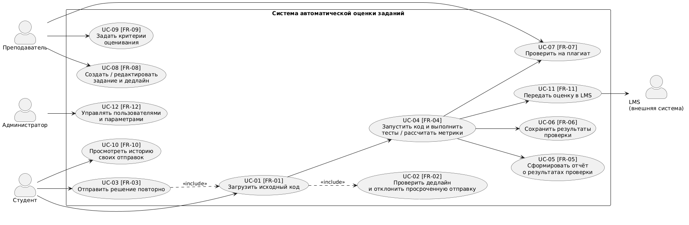

# Лабораторная работа №1. Формулирование требований к программной системе

| Поле | Значение |
|---|---|
| **Студент** | Нуритдинова Кристина Владимировна |   
| **Группа** | 1 |
| **Вариант** | 4. Система автоматической оценки заданий по программированию |
| **Постановка задачи** | [Возможные варианты.docx](https://docs.google.com/document/d/1l9oZuIYZcej5SZnC7KZQ3wCePuF3-xnC/edit?usp=drive_link&ouid=107728663328425679052&rtpof=true&sd=true)|
| **Репозиторий** | https://github.com/krissieer/Software-system-architecture-design |
| **Дата сдачи** | 19.11.26 |

**Тема:** Анализ предметной области и формулирование требований к программной системе.

**Цель работы:** Научиться анализировать поставленную задачу, выделять заинтересованных лиц, формулировать функциональные и нефункциональные требования, представлять результаты в виде диаграммы вариантов использования.

---

## Краткое описание системы

Система предназначена для автоматизированной проверки простых заданий по программированию. Студент загружает исходный код решения, система запускает его в изолированной среде, выполняет заданные преподавателем тесты, рассчитывает показатели, проверяет на плагиат, формирует результат проверки. Преподаватель управляет заданиями, критериями и сроками сдачи, а студенты могут отправлять решения повторно до установленного срока. Система должна взаимодействовать с существующей университетской LMS, при этом интеграция проектируется с минимальным вмешательством в её основную систему.
Основная ценность — снижение нагрузки на преподавателей при сохранении высокого качества оценки и академической честности.

---

## Оглавление

1. [Стейкхолдеры](#1-перечень-заинтересованных-лиц-стейкхолдеров)
2. [Функциональные требования](#2-перечень-функциональных-требований)
3. [Диаграмма вариантов использования](#3-диаграмма-вариантов-использования)
4. [Нефункциональные требования](#4-перечень-нефункциональных-требований)
5. [Предположения](#5-перечень-сделанных-предположений-повышенная-сложность)


---

## 1. Перечень заинтересованных лиц (стейкхолдеров)

В проекте выделено шесть основных стейкхолдеров. К внутренним относятся студенты, преподаватели, администратор и университет как организация. Внешним стейкхолдером является существующая LMS: она не входит в разрабатываемую систему, но участвует в обмене данными. Также отдельно выделена ИТ-служба университета, поскольку ей предстоит обеспечивать эксплуатацию решения и интеграцию с мэйнфреймом.

| ID | Стейкхолдер | Роль | Интересы / цели | Влияние |
|---|---|---|---|---|
| SH-01 | Студент | Основной пользователь системы | Загружать код, получать обратную связь и оценку, улучшать решение повторными отправками до дедлайна, видеть историю отправок и результаты проверки | Высокое: многочисленная группа ежедневных пользователей, от удобства и корректности работы системы зависит возможность выполнения учебных заданий |
| SH-02 | Преподаватель | Автор заданий, правил оценивания | Создавать задания, задавать сроки и критерии оценки; проверять результаты запусков и отчёты о плагиате; выставлять и подтверждать оценки | Высокое: определяет учебные задания, правила проверки и сроки, использует результаты системы при оценивании |
| SH-03 | Администратор системы | Управление учётными записями и настройками | Управлять ролями и доступом; контролировать работоспособность системы, хранение данных и выполнение резервного копирования | Высокое: отвечает за конфигурацию и эксплуатацию системы, имеет административные полномочия |
| SH-04 | ИТ-служба университета | Техническая поддержка и интеграция | Обеспечить безопасную эксплуатацию; минимизировать затраты на поддержку и инфраструктур | Среднее: влияет на техническую реализуемость и сопровождение, но не определяет учебные критерии |
| SH-05 | Университет | Заказчик и владелец образовательного процесса | Снизить трудозатраты на проверку работ; получать достоверные оценки, иметь отчётность по успеваемости | Высокое: определяет бюджет, цели внедрения и требования к результатам образовательного процесса |
| SH-06 | Университетская LMS | Внешняя информационная система | Передавать в систему сведения о курсах, студентах и заданиях, получать результаты оценивания; сохранить совместимость с существующими процессами | Среднее: технические возможности и ограничения LMS определяют формат и способ интеграции, однако сама LMS не управляет логикой проверки кода |

---

## 2. Перечень функциональных требований

Сформулировано 12 функциональных требований. Приоритет **Must** присвоен функциям, без которых невозможно выполнить основную задачу автоматизированной проверки. **Should** обозначает важные функции, повышающие контролируемость и удобство эксплуатации. **Could** — функции, которые допустимо реализовать при наличии дополнительных ресурсов. Приоритеты учитывают ограниченный бюджет университета.

| ID | Требование | Стейкхолдер | Приоритет (MoSCoW) | Обоснование |
|---|---|---|---|---|
| FR-01 | Система должна предоставлять студенту возможность загрузить исходный код решения для выбранного задания | SH-01 | Must | Загрузка решения — начальный и обязательный шаг процесса проверки |
| FR-02 | Система должна отклонять отправку решения, если текущие дата и время позже дедлайна | SH-01, SH-02 | Must | Обеспечивает соблюдение дедлайна и единые правила для всех студентов |
| FR-03 | Система должна принимать от одного студента неограниченное количество отправок по одному заданию до наступления срока сдачи | SH-01, SH-02 | Must | В условии предусмотрена возможность повторной отправки для улучшения оценки |
| FR-04 | Система должна запускать загруженный код в изолированной среде и выполнять тесты/рассчитывать метрики | SH-02, SH-01 | Must | Реализует основной механизм автоматизированного оценивания |
| FR-05 | Система должна предоставлять подробный отчёт о результатах проверки (пройденные/проваленные тесты, сообщения об ошибках) | SH-02, SH-01 | Must | Обеспечивает объяснимость выставленной оценки, снижает нагрузку на преподавателей вопросами |
| FR-06 | Система должна сохранять исходный код каждой отправки, параметры запуска, версию критериев, результаты тестов/метрик, дату и время проверки, а также итоговый балл | SH-02, SH-03, SH-05 | Must | Необходимо для постоянного хранения и последующей проверки результатов |
| FR-07 | Система должна сравнивать отправленные решения студентов между собой и формировать отчёт о сходстве с указанием совпадающих фрагментов или показателей сходства | SH-02, SH-05 | Must | Выполняет требование обнаружения плагиата среди работ |
| FR-08 | Система должна предоставлять преподавателю возможность создавать и редактировать задания, устанавливать дату и время дедлайна | SH-02 | Must | Преподаватель управляет заданиями и сроками сдачи |
| FR-09 | Система должна предоставлять преподавателю возможность задавать критерии оценивания, включая набор тестов/показателей | SH-02 | Must | Позволяет адаптировать автоматическую проверку к содержанию конкретного задания |
| FR-10 | Система должна предоставлять студенту просмотр истории его отправок, результатов проверок и полученных баллов | SH-01 | Should | Позволяет отслеживать прогресс и понимать, улучшилось ли решение после повторной отправки |
| FR-11 | Система должна передавать итоговую оценку и статус сдачи в LMS университета | SH-04, SH-05, SH-06 | Should | Требование интеграции; LMS — основная точка доступа студентов |
| FR-12 | Администратор должен иметь возможность управлять пользователями, ролями и параметрами системы | SH-03, SH-04 | Should | Обеспечение эксплуатации при малом бюджете |

---

## 3. Диаграмма вариантов использования

Диаграмма подготовлена в PlantUML. На ней показаны акторы, непосредственно взаимодействующие с системой. Университет как организация указан в перечне стейкхолдеров, но не выделен в отдельного актора, поскольку его интересы реализуются через действия сотрудников и требования к результатам внедрения.

**Связь с требованиями:** ID соответствующего FR указан в названии Use Case (например, `UC-03 [FR-03]`).

### Диаграмма

```
@startuml
left to right direction
skinparam packageStyle rectangle
skinparam actorStyle awesome
skinparam shadowing false

actor "Студент" as Student
actor "Преподаватель" as Teacher
actor "Администратор" as Admin
actor "LMS\n(внешняя система)" as LMS

rectangle "Система автоматической оценки заданий" {
  usecase "UC-01 [FR-01]\nЗагрузить исходный код" as UC01
  usecase "UC-02 [FR-02]\nПроверить дедлайн\nи отклонить просроченную отправку" as UC02
  usecase "UC-03 [FR-03]\nОтправить решение повторно" as UC03
  usecase "UC-04 [FR-04]\nЗапустить код и выполнить\nтесты / рассчитать метрики" as UC04
  usecase "UC-05 [FR-05]\nСформировать отчёт\nо результатах проверки" as UC05
  usecase "UC-06 [FR-06]\nСохранить результаты\nпроверки" as UC06
  usecase "UC-07 [FR-07]\nПроверить на плагиат" as UC07
  usecase "UC-08 [FR-08]\nСоздать / редактировать\nзадание и дедлайн" as UC08
  usecase "UC-09 [FR-09]\nЗадать критерии\nоценивания" as UC09
  usecase "UC-10 [FR-10]\nПросмотреть историю\nсвоих отправок" as UC10
  usecase "UC-11 [FR-11]\nПередать оценку в LMS" as UC11
  usecase "UC-12 [FR-12]\nУправлять пользователями\nи параметрами" as UC12
}

Student --> UC01
Student --> UC03
Student --> UC10

Teacher --> UC08
Teacher --> UC09
Teacher --> UC07

Admin --> UC12

UC01 ..> UC02 : <<include>>
UC03 ..> UC01 : <<include>>
UC01 --> UC04
UC04 --> UC06
UC04 --> UC07
UC04 --> UC05
UC04 --> UC11

UC11 --> LMS

@enduml
```





### Описание ключевого сценария

| Поле | Значение |
|---|---|
| **Use Case** | UC-04 [FR-04] Запустить и оценить код |
| **Актор** | Система (инициируется после успешной загрузки студентом) |
| **Предусловие** | Код загружен (UC-01), дедлайн не истёк (UC-02), критерии оценки заданы преподавателем (UC-09) |
| **Основной поток** | 1. Система помещает код в изолированную среду выполнения.<br>2. Выполняет компиляцию<br>3. Последовательно запускает набор тестов и собирает метрики.<br>4. Вычисляет оценку по заданным критериям.<br>5. Инициирует проверку на плагиат (UC-07).<br>6. Сохраняет полный результат прогона (UC-08).<br>7. Передаёт итоговую оценку в LMS (UC-11).<br>8. Формирует отчёт для студента (UC-05) |
| **Постусловие** | Оценка и полный лог прогона сохранены, студент и преподаватель могут их просмотреть, оценка отражена в LMS |
| **Альтернативный поток** | 2а. Ошибка компиляции → оценка = 0, сохранить лог ошибок, уведомить студента.<br>5а. Высокий уровень схожести при проверке плагиата → пометить работу, уведомить преподавателя, оценка может быть анулирована. |

---

## 4. Перечень нефункциональных требований

Выбраны пять нефункциональных характеристик: производительность, безопасность, надежность, доступность и масштабируемость. Они обусловлены ожидаемым количеством студентов, исполнением недоверенного кода, необходимостью проверять оценки и ограниченным бюджетом.
Отброшены требования высокого уровня, которые не укладываются в бюджет и не являются критичными для MVP.


| ID | Категория | Требование | Метрика / критерий приёмки | Почему выбрано |
|---|---|---|---|---|
| NFR-01 | Performance | Время полной проверки одной отправки (компиляция + тесты + плагиат) | ≤ 1 минуты для 95 % отправок при типичном наборе из 10–15 тестов | Студенты ждут обратной связи; при > 300 студентах в год пиковые нагрузки должны оставаться приемлемыми |
| NFR-02 | Security | Изоляция выполнения студенческого кода | Каждый запуск выполняется в отдельном контейнере с отключённым доступом к сети, файловой системе и другим контейнерам | Критично: выполняется произвольный код студентов |
| NFR-03 | Reliability / Auditability | Неизменяемость и проверяемость результатов | Для всех завершенных проверок сохраняются исходный код, версии тестов, логи и результаты; возможность повторного прогона сохранённого кода | Оценки должны быть постоянными и поддаваться проверке |
| NFR-04 | Availability | Система должна быть доступна студентам и преподавателям в периоды выполнения и сдачи заданий | Доступность пользовательского интерфейса и API — не менее 99,5% в месяц, за исключением заранее объявленных окон технического обслуживания. | Недоступность вблизи дедлайна может лишить студентов возможности сдать работу и повлиять на учебный процесс |
| NFR-05 | Scalability | Система должна поддерживать увеличение числа пользователей и одновременных проверок без изменения логики приложения | При нагрузочном тестировании система должна обслуживать не менее 50 одновременных пользовательских сессий и не менее 10 параллельных запусков кода | Сдача заданий может создавать пиковую нагрузку|


---

## 5. Перечень сделанных предположений (повышенная сложность)

Из-за неполноты исходной постановки сделаны следующие предположения, влияющие на объём работ, архитектуру и требования

| ID | Предположение | Влияние на требования |
|----|---------------|-----------------------|
| A-01 | Проверка на плагиат выполняется в пределах работ одного курса/задания + архива предыдущих семестров того же курса. Глобальный поиск по интернету не требуется | Упрощает FR-07 и снижает вычислительную нагрузку (NFR-01) |
| A-02 | Хранение исходных кодов и логов необходимо минимум в течение срока обучения студента + 1–2 года (для апелляций и аккредитации) | Влияет на NFR-03 и требования к объёму хранилища |
| A-03 | Доступ к системе осуществляется через браузер; аутентификация может быть локальной либо связанной с LMS, в зависимости от реально доступных механизмов интеграции. | Требуются веб-интерфейс и разграничение ролей; способ единого входа нельзя считать подтверждённым до обследования LMS |
| A-04 | Система используется в университете с ограниченным ИТ-бюджетом; предпочтение отдаётся свободному программному обеспечению и развёртыванию на имеющейся инфраструктуре, если она удовлетворяет требованиям безопасности и производительности | Архитектура должна избегать обязательных платных внешних сервисов; в приоритете  простота сопровождения и контролируемые эксплуатационные расходы |
| A-05 | Повторные отправки разрешены без ограничения количества только до дедлайна; после дедлайна новые отправки блокируются. Ранее отправленные решения и оценки остаются доступными. | FR-02, FR-03, FR-06; серверное время является источником истины для проверки срока |
